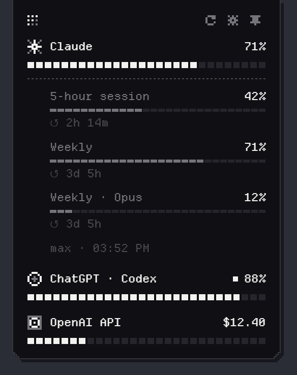

<div align="center">


<h1>AI Usage Widget</h1>

<p><b>Your Claude and ChatGPT plan limits and your API spend, in a small pixel widget on your desktop.</b></p>

<p>
  <a href="https://github.com/c4nng/ai-usage-widget/actions/workflows/ci.yml"></a>
  
  
  <a href="LICENSE"></a>
</p>



</div>

<br>

You're halfway through a long session and Claude says you've hit your limit. AI Usage Widget is there so you can see that coming. It sits on your desktop behind your windows, shows how much of each plan you've used and when it resets, and never takes the keyboard from the app you're working in.

## What it tracks

| | What you see | What it needs |
| --- | --- | --- |
| **Claude Pro / Max** | 5-hour session, weekly limit, weekly Opus limit, reset countdowns | A [Claude Code](https://claude.com/claude-code) login |
| **ChatGPT Plus / Pro / Team** | 5-hour and weekly Codex limits | A [Codex CLI](https://github.com/openai/codex) login |
| **Anthropic API** | Month-to-date spend, optionally against a budget | An Admin API key |
| **OpenAI API** | Month-to-date spend, optionally against a budget | An Admin API key |

Each provider you add becomes a row, and you can add more than one of the same kind (a work and a personal API org, for example). The row shows the number closest to running out. Click it to see every limit, when each one resets, and which plan you're on.

## Features

- **Two placements.** A small *drop* hangs from the top edge of the screen and shows your most pressing number. Hover it and the panel opens; move away and it closes again. Click to keep it open and drag it sideways to move it. Or switch to a *note* you can put anywhere on the desktop.
- **Never in the way.** By default it stays on the desktop layer, below every window, including after "Show desktop". If you want it always visible, turn on *Show above other windows*. Clicking it never takes keyboard focus.
- **Easy on the APIs.** It refreshes in the background and backs off when a service says "too many requests". When a login expires it stops calling the network and waits until you sign in again.
- **Private by design.** API keys are stored in Windows Credential Manager. Tokens go only to the service that issued them. There's no telemetry.
- **Quiet look.** Monochrome pixel UI in [Departure Mono](https://departuremono.com), with dark, light and system themes and adjustable background opacity.
- **Small.** Built with Tauri and Rust, with no Electron and no frontend framework. It runs from the tray with no taskbar button and can start when you sign in.

## Install

1. Download the latest `.exe` (recommended) or `.msi` installer from [Releases](../../releases).
2. Run it. The `.exe` installs for your user only and doesn't need admin rights.

Windows 10 and 11 are supported. Both already include WebView2.

## Setup

Open **Settings** with the gear icon on the widget, or right-click the tray icon. If Claude Code or Codex is already signed in when the widget first starts, it adds those providers for you.

<details>
<summary><b>Claude plan</b> (Pro / Max)</summary>

Sign in to [Claude Code](https://claude.com/claude-code) once with your Pro or Max account. The widget reads that login from `%USERPROFILE%\.claude\.credentials.json`.
</details>

<details>
<summary><b>ChatGPT plan</b> (Codex)</summary>

Run `codex login` in the [Codex CLI](https://github.com/openai/codex) and choose ChatGPT sign-in, not an API key. The widget reads `%USERPROFILE%\.codex\auth.json`.
</details>

<details>
<summary><b>Anthropic API spend</b></summary>

Create an **Admin** API key (`sk-ant-admin…`) at console.anthropic.com → Settings → Admin keys and paste it into the provider. You can also set a monthly budget; the bar then fills toward it.
</details>

<details>
<summary><b>OpenAI API spend</b></summary>

Create an **Admin** API key (`sk-admin-…`) at platform.openai.com → Settings → Admin keys and paste it into the provider. A monthly budget is optional here too.
</details>

<details>
<summary><b>Using the CLIs inside WSL?</b></summary>

Their logins are stored in the Linux filesystem. Set the provider's *Login file* to the WSL path, for example:

```
\\wsl.localhost\Ubuntu\home\<you>\.claude\.credentials.json
```
</details>

## How refreshing works

- Plan limits are checked every 5 minutes by default. You can change this in Settings.
- API spend is checked at most every 30 minutes, since the providers don't update it more often.
- If a service answers "too many requests", the next check waits longer each time, up to an hour.
- An expired or missing login isn't retried over the network. The widget watches the CLI's login file and refreshes when it changes.
- Results are cached, so restarting the app doesn't refetch data that's still fresh. Waking the PC from sleep starts a refresh.

## Privacy

- API keys are kept in Windows Credential Manager, never in the config file.
- CLI logins are read from disk on each refresh. A token is sent only to the service that issued it (Anthropic or OpenAI).
- The widget never refreshes CLI tokens itself. Refresh tokens rotate, so doing that would sign you out of the CLI. When a login expires, open the CLI once and the widget picks up the new token.
- No telemetry, analytics or any other network traffic.

Settings are stored in `%APPDATA%\io.github.aiusagewidget\`.

## Good to know

The plan-limit endpoints (`api.anthropic.com/api/oauth/usage` and `chatgpt.com/backend-api/wham/usage`) are the same ones the official CLIs use, but they are **not public, documented APIs** and can change without notice. The parsers are lenient and skip fields they don't recognize. If a row stops working, please [open an issue](../../issues) with the error shown on the row. The Admin cost APIs are documented and stable.

This project is not affiliated with Anthropic or OpenAI.

## Building from source

Prerequisites (on Windows):

- [Node.js](https://nodejs.org) 20+
- [Rust](https://rustup.rs) (stable)
- Microsoft C++ Build Tools, see the [Tauri prerequisites](https://v2.tauri.app/start/prerequisites/)

```powershell
npm install
npm run tauri dev      # run with hot reload
npm run tauri build    # installers land in src-tauri/target/release/bundle/
```

The parser and scheduling tests run on any OS and don't need the Tauri toolchain:

```sh
npm run test:core
```

Releases are built by GitHub Actions. Push a tag like `v0.2.0` and a draft release with the installers is created.

### Project layout

```
src/                     widget + settings UI (TypeScript, no framework)
src-tauri/src/           app shell: windows and their layer, tray, config, credential store, HTTP, background refresh
src-tauri/usage-core/    pure parsers, report model and scheduling rules, unit-tested against fixtures
```

### Adding a provider

1. Add a variant to `ProviderKind` in `src-tauri/usage-core/src/model.rs`.
2. In `usage-core`, write a parser that turns the provider's response into `Usage { plan, meters }`, along with tests.
3. Add the fetch function in `src-tauri/src/providers.rs` and wire it into `fetch_one`.
4. Add the kind to `src/types.ts`, its name and hint to `src/i18n.ts`, and a 7×7 pixel glyph to `src/pixel.ts`.

Refresh intervals and back-off rules are in `src-tauri/usage-core/src/schedule.rs` and are unit-tested too.

## Contributing

Issues and pull requests are welcome, especially new providers and fixes for changed endpoints. Before opening a PR, run `npm run test:core` and `npm run typecheck`.

## License

[MIT](LICENSE)

The bundled [Departure Mono](https://departuremono.com) font is by Helena Zhang and licensed under the SIL Open Font License ([`src/fonts/DepartureMono-LICENSE.txt`](src/fonts/DepartureMono-LICENSE.txt)).
